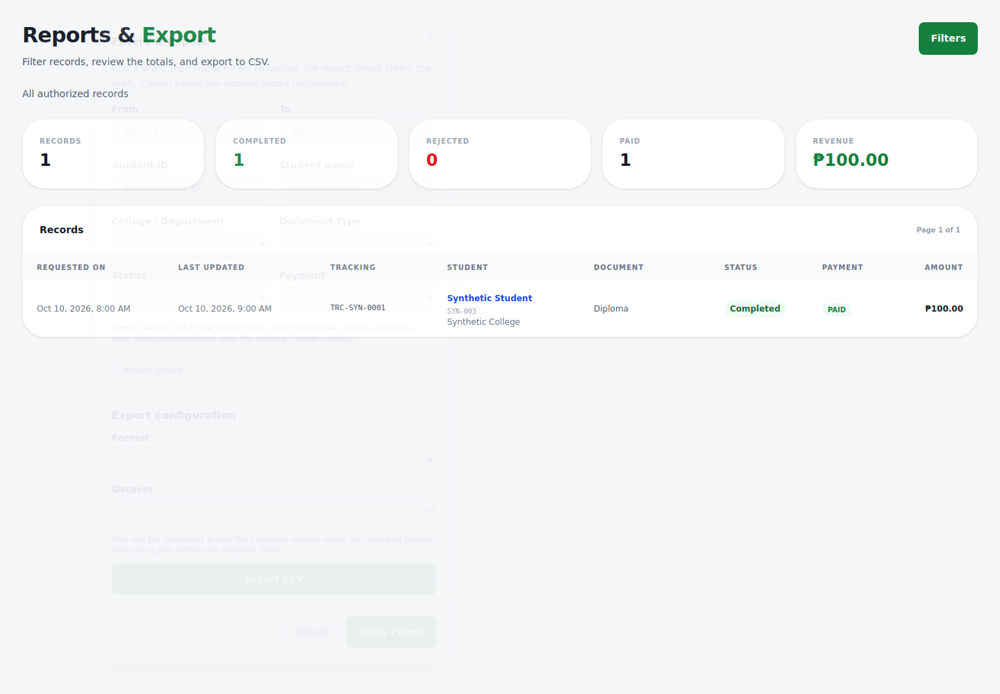
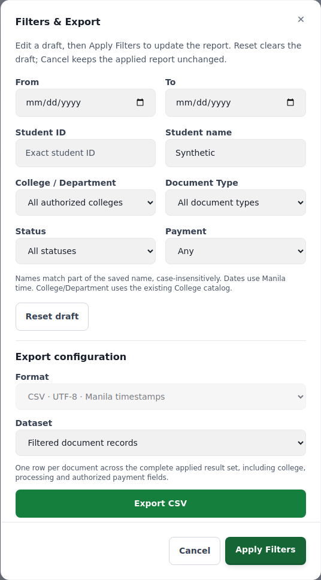
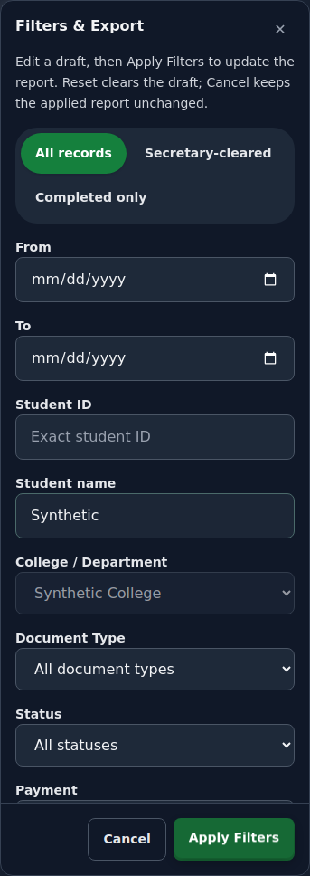
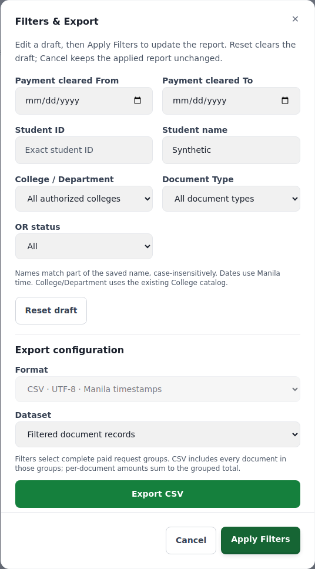

# Revision 2 Batch 9 — Reports & Export

Implements **TRACE-58/59/60** from the newer guide. The next guide batch is Support / Messaging UI (Batch 10). No production migration or deployment has been performed.

## Account-free walkthrough

1. Open Reports & Export (Admin, Window 1 or Secretary), or Finance's Transactions & OR Copies. The main view keeps the records/KPIs and a concise applied-filter summary. The primary header action is **Filters**.
2. Open **Filters & Export**. The shared TRACE modal holds the entire configuration form and CSV action. Select student ID/name, college/department, document type and the appropriate dates/status fields. Document types come from the institutional catalog, including inactive types for historical reporting. College/Department uses the existing College catalog; no duplicate department table was created.
3. Editing changes a local draft and makes no report request. **Apply Filters** commits the draft to the displayed report; the modal stays open so you can export after the applied results load. **Reset draft** clears draft values without changing the report. **Cancel**, Escape or backdrop close discards the unapplied draft; reopening starts with the applied values.
4. **Export CSV** is disabled for an unapplied draft, a pending/failed report or a download already in progress. Download errors retain the modal and draft. An empty document result produces the shared header with zero data rows. More than 10,000 matching documents produces an explicit narrow-the-filters error; the API never silently returns a partial document export.
5. Secretary college options are locked to the assigned college. The backend rejects forged cross-college filters and applies the saved routing-college scope to records, totals, breakdowns and exports. Missing staff college assignment fails closed.

The modal follows the main [TRACE Figma](https://www.figma.com/design/78A3HTREQ86GIN9ZxvDBSv/TRACE-Draft?node-id=177-691) chrome: 535 px desktop panel, rounded white surface, pine-green primary action and neutral secondary action. The confirmation frame was inspected as the established modal reference; the new filter fields extend that design rather than copying its request/attachment content. No new static illustration is part of this filter UI. Existing ModalShell supplies scrolling, pinned actions, keyboard containment, focus restoration and drill/reduced-motion behavior.

## Filter and dataset semantics

| Field / dataset | Meaning |
| --- | --- |
| Student ID | Exact trimmed ID, maximum 50 characters. |
| Student name | Literal substring, case-insensitive via parameterized `LOWER(...) LIKE LOWER(?)`. `%`, `_` and `!` are escaped rather than treated as wildcards; maximum 255 characters. |
| College / Department | Active authoritative College reference ID. Secretary scope is forced from the account and cannot be expanded by a query parameter. Saved request routing snapshots remain authoritative. |
| Document type | Catalog name; the API rejects unknown values. Historical/inactive catalog types remain available for reporting. |
| Report From / To | Inclusive Manila calendar dates against request creation time. Exact YYYY-MM-DD validation rejects impossible dates and inverted ranges. |
| Finance From / To | Inclusive Manila calendar dates against the group's earliest recorded payment-clearance time. Missing historical payment dates are not invented. |
| Finance filters | Select complete paid request groups: a matching document type/name/college selects its whole group. The table remains one row per payment group; its amount is the full group total. CSV expands every paid document in those matching groups, so document amounts reconcile with the grouped total. |
| Student-category exports | Remain separate, labelled one-row-per-student datasets for Active/Alumni/Others/All. Applied student ID/name and college filters apply. Document type/status/payment/date filters do not apply to student records. Secretary scope still applies. |

## Shared document CSV contract

All staff document exports and Finance transaction exports use **one row per document**, the same whitelist, header names and order below. Every export includes the complete matching document set, independently of the displayed page, up to the explicit refusal limit. Missing/not-applicable values are empty cells; amounts/rates are decimal PHP values without currency symbols so they sort numerically. Fee Breakdown is escaped JSON of the recorded fee lines, not a recalculation using today's prices. Shared receipt information may repeat across a request's document rows; **Amount (PHP)** is the document's own amount and must not be multiplied by group size.

Timestamps use ISO-style `YYYY-MM-DDTHH:mm:ss+08:00`; date-only fields remain YYYY-MM-DD. SQL epoch projections preserve timestamp interpretation across API host timezones. The HTTP download has a UTF-8 BOM, CRLF records and RFC 4180 quoting. Leading spreadsheet formulas, including whitespace-prefixed formulas, are neutralized. Credentials, recovery tokens, private chats, image/OCR bodies and file paths are excluded from the CSV whitelist.

| Order | Header | Source key |
| --- | --- | --- |
| 1 | Document ID | `id` |
| 2 | Tracking Number | `tracking_number` |
| 3 | Request Group | `request_group_id` |
| 4 | Document Request | `document_sequence_number` |
| 5 | Student ID | `student_id` |
| 6 | Student Name | `student_name` |
| 7 | College ID | `college_id` |
| 8 | College/Department | `course` |
| 9 | Program/Course | `program` |
| 10 | Document Type | `document_type` |
| 11 | Status | `current_status` |
| 12 | Payment | `payment_status` |
| 13 | Copies | `copies` |
| 14 | Pages | `page_count` |
| 15 | Amount (PHP) | `amount` |
| 16 | Base Rate (PHP) | `base_fee` |
| 17 | Rental Rate (PHP) | `rental_fee` |
| 18 | Special Rate (PHP) | `special_fee` |
| 19 | Fee Breakdown | `fee_lines` |
| 20 | Purpose | `purpose` |
| 21 | Requested On (Manila) | `created_at` |
| 22 | Last Updated (Manila) | `updated_at` |
| 23 | Estimated Ready Date | `estimated_ready_date` |
| 24 | Assigned Staff ID | `assigned_clerk_id` |
| 25 | Assigned Staff | `assigned_staff_name` |
| 26 | Assigned Desk | `assigned_staff_desk` |
| 27 | Priced By ID | `priced_by_clerk_id` |
| 28 | Priced On (Manila) | `priced_at` |
| 29 | Payment Channel | `payment_channel` |
| 30 | Payment Reference | `payment_reference` |
| 31 | Payment Cleared (Manila) | `payment_cleared_at` |
| 32 | OR Number | `or_number` |
| 33 | OR Date | `or_date` |
| 34 | OR Copy Uploaded (Manila) | `or_uploaded_at` |
| 35 | OR Status | `receipt_status` |
| 36 | Cashier ID | `logged_by_clerk_id` |

[Download the synthetic sample CSV](batch9-report-sample.csv). It contains **2 documents / 1 request group / PHP 300.00**. Both rows belong to Synthetic College and Synthetic Student, with explicit Manila timestamps; no real account or uploaded receipt is included. A CSV parser verifies the header, two unique document IDs, one group, 36 cells per record and the summed amount.

## Root causes and changes

The earlier useReports hook mutated the live filter object on every keystroke, so Apply did not establish a separate boundary. The inline configuration and ExportDropdown were independent UI recipes; Finance used its own filters/columns and one-group export. Document CSV queries requested only 10,000 rows without detecting an overflow, which could silently truncate a broader selection.

The new shared ReportFiltersModal holds the draft; hooks own applied filters and scope-aware loading. Shared report-filter validation and parameterized model filters drive rows, counts, KPI summaries, breakdowns and exports. Finance preserves payment groups in its screen and expands their documents into the shared CSV. A 10,001st sentinel row detects oversized exports. Blob JSON errors are decoded so the server's narrowing/authorization error is visible. Report pages no longer issue unused global analytics requests; the Admin Analytics screen retains its existing measured-data workflow.

## Verification and limits

- Backend: **1,374 tests in 103 files pass**, including forged college filters, malformed identity/reference filters, impossible dates, literal wildcard escaping, Manila boundaries, export overflow, consistent headers, complete Finance groups and private-field/formula protection.
- Frontend: **866 tests in 92 files pass**, including draft/cancel/reset/apply behavior, current-scope/stale-response checks, pending/error export guards, Finance receipt workflows and preserved status badges/profile actions.
- Final focused regressions: **49 tests in 4 files pass**, including Blob error decoding and blocking stale Finance results/exports after a scope-load failure.
- ESLint, production build and `git diff --check` pass. Existing PostCSS/chunk-size build advisories remain.
- Chromium: 32 layout cases across the four roles, 320/375/768/1440 px, light/dark themes, plus 200% text, keyboard containment, Escape focus restoration and reduced motion. The synthetic API harness checks that draft edits issue no report request, Apply sends the selected scope, Secretary options stay locked and no global analytics request is made. Enlarged text exposed a Finance title overflow; shared wrapping fixes it.

These are local unit and mocked browser checks, not a live MySQL/export-delivery or physical-phone acceptance claim. Reconcile a real filtered row count and Finance group total on staging before deployment. The cached test browser was incomplete; an intact test-only Chromium binary was restored for these checks. No browser package was added to the application dependencies.

## Migrations

**Batch 9 adds no database migration and no environment variables.** It uses the existing catalog, fee-schedule, receipt/payment-method and Batch 8 routing fields. Deploy the matching API/frontend; old clients cannot assume the previous Finance CSV shape. The consolidated [DEPLOYMENT_CHECKLIST.md](DEPLOYMENT_CHECKLIST.md) tracks every new batch's migration and prerequisites, including the still-unapplied-by-this-work alumni and intake-scope scripts. [MIGRATION_ROLLOUT.md](MIGRATION_ROLLOUT.md) keeps the complete preserving dependency order.
